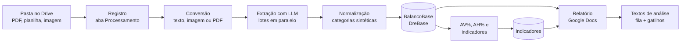

# RMA Pipeline

[](https://github.com/FIlIpeDiBr/rma-pipeline-apps-script/actions/workflows/ci.yml)

Pipeline em Google Apps Script que recebe balancetes e DREs em PDF, planilha ou imagem, extrai os números com um LLM, calcula indicadores financeiros e monta o Relatório Mensal de Atividades (RMA) de cada empresa no Google Docs.

Foi construído para um escritório de contabilidade. Esta é a edição pública: sem dados de clientes, sem identificadores e sem os modelos de documento.

**Demonstração:** [abrir o portal](https://script.google.com/macros/s/AKfycbwswcC9jH91-_CXEDRWr-SN4ekYECVFh924L-dVy3-W3J5xnM6UaAXhsvaBriqlOZvS/exec?authuser=0). Pede login com uma Conta Google. A instância não tem dados reais, e qualquer visitante pode alterar o que está lá.

*[English version](README.en.md)*

## Fluxo



1. **Entrada.** Os arquivos chegam a uma pasta do Drive. O pipeline registra cada um, identifica empresa, período e tipo pelo nome e pelo conteúdo, e descarta versões antigas do mesmo documento.
2. **Extração.** Cada documento vai ao modelo como texto, imagem ou PDF, o que funcionar melhor para aquele arquivo. A resposta volta em JSON e é reconciliada com um plano fixo de categorias sintéticas.
3. **Cálculo.** Análise vertical e horizontal, e um catálogo de 23 indicadores (liquidez, endividamento, margens, EBITDA) definido por fórmulas declarativas. Empresas de um mesmo grupo econômico também são consolidadas.
4. **Relatório.** O relatório nasce de um modelo no Google Docs com marcadores para valores, tabelas, gráficos e textos de análise escritos pelo modelo de linguagem. Quem mantém o modelo não precisa mexer em código.

A operação acontece por um portal web (HTML servido pelo próprio script) ou pelo menu da planilha.

## Decisões de engenharia

**Trabalhar dentro do limite de 6 minutos do Apps Script.** Uma extração em lote ou um relatório com dezenas de textos de IA não cabe em uma execução. As etapas longas viraram filas: cada execução processa o que dá dentro de um prazo, devolve o resto à fila e agenda um gatilho para continuar. Um `LockService` impede duas extrações simultâneas, e linhas que ficaram em `PROCESSANDO` por uma execução interrompida são recolocadas na fila na rodada seguinte. Ver [`extraction.gs`](src/extraction.gs) e [`report_ai_queue.gs`](src/report_ai_queue.gs).

**Paralelismo e custo nas chamadas ao modelo.** As requisições saem em lotes por `UrlFetchApp.fetchAll`, e a falha de um documento não derruba os outros. O modelo é escolhido pelo tamanho estimado do documento: um mais barato para textos curtos, um mais capaz para documentos longos e PDFs enviados como arquivo. Ver [`openai_service.gs`](src/openai_service.gs).

**Não confiar na saída do LLM.** O prompt exige JSON estrito, e mesmo assim a resposta passa por reparo (cercas de markdown, expressões como `100 + 200` em campos numéricos, vírgulas sobrando) antes de ser rejeitada. Os nomes de conta são reconciliados com as categorias canônicas por normalização e apelidos. Prompt e resposta ficam gravados na aba `DebugIA` para auditoria.

**Indicadores por fórmula, não por LLM.** Os números do relatório saem de fórmulas declaradas no código, como `safeDivide({{lucro_liquido}}, {{receita_liquida}}) * 100`, avaliadas por um parser descendente recursivo próprio ([`formula_parser.gs`](src/formula_parser.gs)) em vez de `eval` ou `new Function`. Um teste diferencial compara o parser com o JavaScript nativo em 6.900 expressões geradas a partir do catálogo. O LLM só entra quando falta dado para alguma fórmula, e apenas para os indicadores que ficaram sem valor; com DRE e balancete completos, nenhuma chamada é feita.

**Relatório configurável por quem não programa.** O modelo do relatório usa uma pequena linguagem de marcadores: `{{periodo(-1)}}`, tabelas com colunas declaradas no cabeçalho, gráficos (`~~(h: empresa(-1)|empresa; v: EBITDA)~~`) e blocos em que o LLM escreve a análise da seção. Referência completa em [`docs/marcadores.md`](docs/marcadores.md).

**Superfície exposta ao navegador.** No Apps Script, toda função global sem sublinhado final pode ser chamada por quem abre o web app, via `google.script.run`. As funções que leem a chave da API, chamam o modelo, leem arquivos do Drive pelo ID ou gravam direto nas bases são privadas; a exclusão de documentos só aceita IDs que estão no cadastro; e um [teste](test/public_api.test.js) falha se alguma delas voltar a ficar exposta ou se o portal chamar uma função que não existe.

**Planilha como banco de dados.** As bases guardam o ID do arquivo de origem em cada linha. Reprocessar um documento substitui as linhas daquela empresa e período, sem duplicar, e excluir um documento remove tudo o que saiu dele. Esquema em [`docs/planilha.md`](docs/planilha.md).

## Código

| Etapa | Arquivos |
|---|---|
| Entrada | [`intake.gs`](src/intake.gs), [`document_metadata.gs`](src/document_metadata.gs), [`file_conversion.gs`](src/file_conversion.gs) |
| Extração | [`extraction.gs`](src/extraction.gs), [`prompts.gs`](src/prompts.gs), [`openai_service.gs`](src/openai_service.gs), [`processing.gs`](src/processing.gs), [`dre_from_balancete.gs`](src/dre_from_balancete.gs) |
| Dados | [`base_sheets.gs`](src/base_sheets.gs), [`data_loaders.gs`](src/data_loaders.gs), [`groups.gs`](src/groups.gs), [`registry.gs`](src/registry.gs) |
| Cálculo | [`percentages.gs`](src/percentages.gs), [`indicator_definitions.gs`](src/indicator_definitions.gs), [`indicator_formulas.gs`](src/indicator_formulas.gs), [`formula_parser.gs`](src/formula_parser.gs), [`indicators.gs`](src/indicators.gs) |
| Relatório | [`report_export.gs`](src/report_export.gs), [`report_templates.gs`](src/report_templates.gs), [`report_queue.gs`](src/report_queue.gs), [`report_ai_queue.gs`](src/report_ai_queue.gs) |
| Marcadores | [`template_placeholders.gs`](src/template_placeholders.gs), [`template_tables.gs`](src/template_tables.gs), [`template_charts.gs`](src/template_charts.gs), [`template_ai_blocks.gs`](src/template_ai_blocks.gs), [`template_group_blocks.gs`](src/template_group_blocks.gs) |
| Interface | [`index.html`](src/index.html), [`IndicadoresSidebar.html`](src/IndicadoresSidebar.html), [`webapp.gs`](src/webapp.gs), [`portal_api.gs`](src/portal_api.gs), [`menu.gs`](src/menu.gs) |
| Apoio | [`config.gs`](src/config.gs), [`constants.gs`](src/constants.gs), [`utils.gs`](src/utils.gs), [`triggers.gs`](src/triggers.gs), [`maintenance.gs`](src/maintenance.gs), [`setup.gs`](src/setup.gs) |

São cerca de 7.500 linhas de Apps Script e 1.900 de HTML/JavaScript no portal. Os nomes de função estão em português porque o domínio (balancete, DRE, categorias sintéticas) é o da contabilidade brasileira.

## Testes

```
npm test
```

Sem dependências: os testes usam o executor nativo do Node (20 ou mais recente). O [`harness`](test/harness.js) carrega os arquivos `.gs` em um contexto isolado, com todos no mesmo escopo global, como no Apps Script, e troca os serviços do Google por dublês em memória.

Os 73 testes cobrem a lógica que não depende de planilha: leitura de nomes de arquivo e cabeçalhos de documentos, números em formato brasileiro, cliente da OpenAI (reparo de JSON, lote, erros), parser e catálogo de indicadores, a consulta ao LLM só quando falta dado, sintaxe dos marcadores e a fila de relatórios.

## Implantação

1. Crie uma planilha Google e um projeto Apps Script vinculado a ela.
2. Copie `.clasp.json.example` para `.clasp.json`, preencha o ID do projeto e envie o código com [`clasp push`](https://github.com/google/clasp). O manifesto já ativa o serviço avançado do Drive, usado na conversão de PDF e XLSX.
3. Execute `configurarPlanilha()` (ou o item *Configurar planilha* do menu). Ela cria as abas `Config` e `Processamento` e as pastas de entrada, processados e relatórios ao lado da planilha ([`docs/planilha.md`](docs/planilha.md)).
4. Em *Propriedades do script*, defina `OPENAI_API_KEY`; na aba `Config`, cadastre ao menos um modelo de relatório.
5. Implante como web app.

## Limitações conhecidas

- Não há teste de integração com Planilhas, Docs e Drive. A suíte cobre a lógica pura; o que escreve em planilha e documento só é exercitado em uso.
- As filas ficam em propriedades do script e são lidas e regravadas sem trava. Duas execuções concorrentes podem perder um item.
- Algumas funções leem colunas da aba `Processamento` por posição, não pelo nome do cabeçalho. Reordenar colunas quebra a extração.
- Quando uma divisão por zero ocorre dentro de uma fórmula com outras operações, o resultado é 0, não vazio. O comportamento foi mantido para não alterar relatórios já emitidos.
- Fora as funções sensíveis, as auxiliares continuam chamáveis pelo cliente do web app. O correto é expor só os pontos de entrada.
- Sobram funções longas, em especial a derivação da DRE a partir do balancete e a replicação de blocos de grupo.
- Planilha como banco de dados tem teto. Com mais empresas e mais histórico, o passo seguinte é um banco relacional e um serviço fora do Apps Script.

Este repositório é a primeira versão do projeto. A segunda foi reescrita em Python (FastAPI), com banco relacional e interface em React.

## Autor

Filipe Dias Brandão · [github.com/FIlIpeDiBr](https://github.com/FIlIpeDiBr)

Código publicado para fins de portfólio. Todos os direitos reservados.
